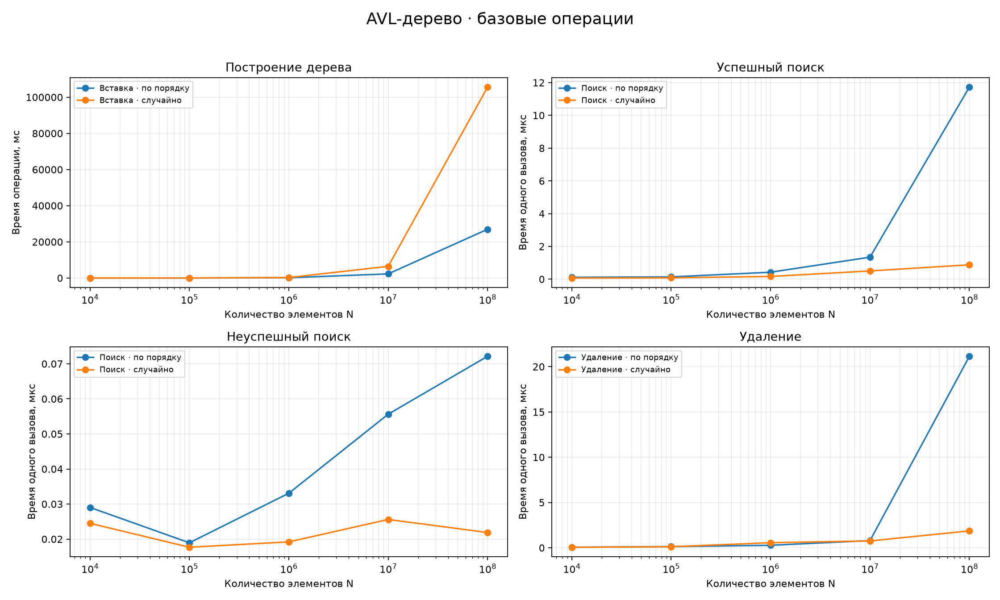
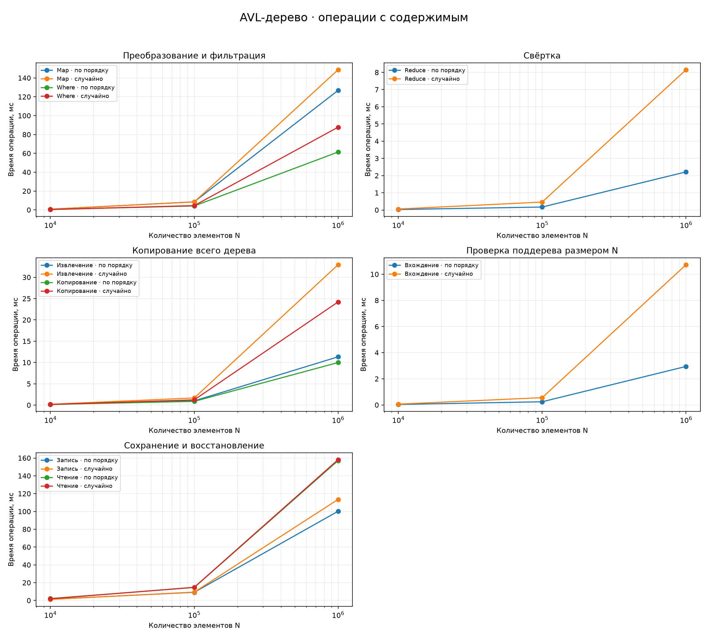
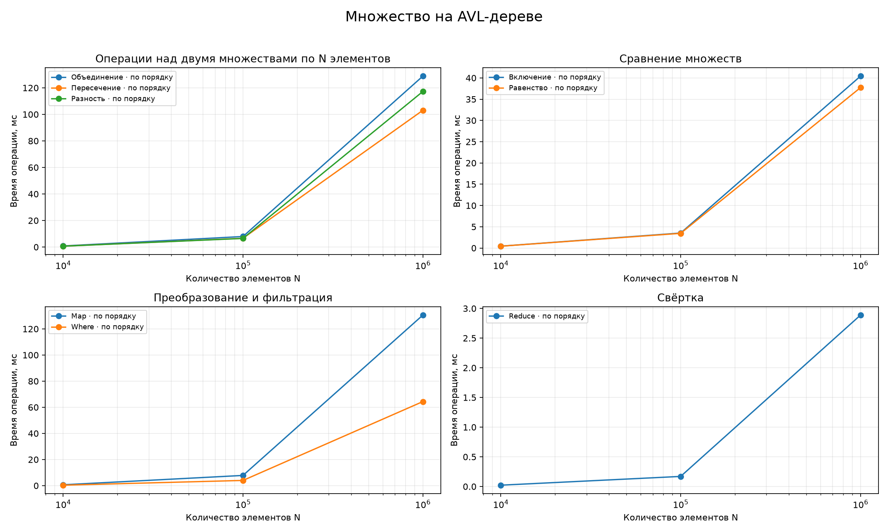

# Результаты измерений ЛР 1

Измерения выполнены 12 октября 2026 года на Apple M5, 16 ГиБ RAM, macOS arm64. Компилятор: Apple clang 21.0.0, вызов через g++; флаги -std=c++17 -Wall -Wextra -O2. Seed 2026. Измеритель — std::chrono::steady_clock.

## Объём проверок

Базовые операции измерены на 10 000, 100 000, 1 000 000, 10 000 000 и 100 000 000 уникальных узлах. Для каждого объёма выполнены построение, 10 000 успешных поисков, 10 000 неуспешных поисков и 10 000 удалений. После удаления проверены реальный размер, порядок, высоты и AVL-баланс.

Сложные операции дерева и операции множества измерены на 10 000, 100 000 и 1 000 000 элементах, по три повтора. Вхождение проверяется на копии всего дерева, чтобы кандидат имел размер N. Множества A и B содержат по N элементов с частичным пересечением.

Порядки вставки дерева: возрастающий и перемешанный через std::shuffle массив уникальных ключей. Множества для отдельных измерений строятся по возрастанию. Большие серии выполнялись последовательно. Генерация, запись CSV, проверки и освобождение временных результатов исключены из времени алгоритма.

## Базовые операции

В таблице — медиана всех сохранённых повторов; для 10^7 и 10^8 доступен один повтор. Построение — полное время N вставок в секундах; остальные столбцы — среднее время одного вызова в микросекундах, вычисленное из измеренной серии.

| N | Порядок | Построение, с | Успешный поиск, мкс | Неуспешный поиск, мкс | Удаление, мкс |
|---:|---|---:|---:|---:|---:|
| 10000 | По возрастанию | 0.0012 | 0.1116 | 0.0290 | 0.0677 |
| 10000 | Случайный | 0.0014 | 0.0706 | 0.0245 | 0.0610 |
| 100000 | По возрастанию | 0.0108 | 0.1370 | 0.0189 | 0.1320 |
| 100000 | Случайный | 0.0132 | 0.0801 | 0.0177 | 0.1152 |
| 1000000 | По возрастанию | 0.1379 | 0.4234 | 0.0331 | 0.2758 |
| 1000000 | Случайный | 0.2562 | 0.1649 | 0.0192 | 0.5623 |
| 10000000 | По возрастанию | 2.2800 | 1.3415 | 0.0556 | 0.7938 |
| 10000000 | Случайный | 6.4532 | 0.5013 | 0.0256 | 0.7551 |
| 100000000 | По возрастанию | 26.9660 | 11.7299 | 0.0722 | 21.1513 |
| 100000000 | Случайный | 105.6298 | 0.8775 | 0.0219 | 1.8654 |

## Операции множества при N равном миллиону

Медиана трёх повторов, полное время одного вызова операции.

| Операция | Время, мс |
|---|---:|
| Объединение | 128.796 |
| Пересечение | 103.046 |
| Разность | 117.233 |
| Включение | 40.420 |
| Равенство | 37.723 |
| Map | 130.548 |
| Where | 64.352 |
| Reduce | 2.887 |

## Графики

## Интерпретация и ограничения

AVL сохранил корректность при обоих порядках вставки вплоть до 100 миллионов узлов. Возрастающий вход не привёл к вырождению в цепочку. Полное время построения увеличивается вместе с N; сравнивать это время с временем одного поиска напрямую нельзя.

Структура и размещение узлов в памяти различаются между порядками вставки. Время зависит также от состояния памяти, кэша и фоновой нагрузки. Большие точки имеют один повтор, поэтому различия поиска и удаления между двумя такими запусками не являются доказательством преимущества одного порядка. Предварительный большой запуск по возрастанию выполнялся во время завершения реализации; эти числа являются измерениями приложения, а не результатом изолированного микробенчмарка.

Для большого случайного запуска /usr/bin/time сообщил пиковую резидентную память 3 520 921 600 байт (около 3,28 ГиБ), пиковый memory footprint 3 615 689 632 байт и 0 swap операций. Это расход всего процесса, включая подготовку массива ключей, а не размер одного узла.

Сложные операции и множества не измерялись на 10^7–10^8. У них отдельный верхний объём 10^6: не следует приписывать им результаты базовых операций. При требовании преподавателя проверить каждую операцию на 10^8 нужно выполнить отдельные серии с большим detailedLimit и достаточной памятью.

Исходные данные: timings.csv — три подробных повтора до 10^6; large_sorted.csv и large_random.csv — по одному базовому прогону до 10^8. Базовые точки до миллиона встречаются во всех трёх файлах, поэтому summary.csv объединяет дополнительные повторы; samples показывает их фактическое количество.

## Проверка программы

Все 12 групп модульных тестов прошли. Сборка с AddressSanitizer и UndefinedBehaviorSanitizer также завершилась без диагностики ошибок. Тестовый счётчик живых объектов подтвердил освобождение узлов, в том числе при ошибках копирования и callback. Отдельно проверены меню всех четырёх типов, операции множеств, генерация, ошибочный ввод, конец ввода, переполнение int и студент с максимально допустимым ID. Каждый основной заголовок подключается самостоятельно.

Проверки через assert должны оставаться включёнными. Оценка преподавателя и совместное начисление рейтинговых баллов определяются исходным заданием, а не этими измерениями.
